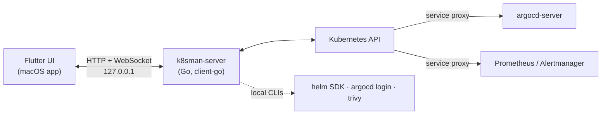

<div align="center">

# k8sman

**A fast, native Kubernetes IDE for your Mac.**

Live tables you shape with jq, an inspector that explains *why* things are broken,
and logs, terminals, port-forwards, Argo CD, Helm and security in one window.

[](https://github.com/matty234/k8sman/releases/latest)
[](#install)
[](LICENSE)

[**Download for macOS**](https://github.com/matty234/k8sman/releases/latest) · [Features](#feature-tour) · [All features](#all-features) · [Build from source](#build-from-source)

</div>


## Why k8sman

- **Live tables you shape with jq.** Every resource type, CRDs included, streams
  in over watches. Columns are jq expressions you edit with a live preview.
- **An inspector that explains why.** k8sman doesn't just print `0/1 ready`. It
  tells you the container crash-looped 7 times with exit code 1, shows the
  termination message, and links you to the previous instance's logs.
- **Logs, terminals and port-forwards in one place.** A bottom dock holds tabs
  for logs and shells. Port-forwards survive pod restarts and app relaunches.
- **GitOps and Helm built in.** You get Argo CD sync, health and per-resource
  diffs, and Helm history diffs, rollbacks and dry-run upgrades, without leaving
  the app.
- **Security insights.** See network exposure, risky RBAC, Pod Security
  failures, best practices and image CVEs ranked across the cluster.

It's a real macOS app: a single universal download with the backend embedded,
nothing to run in your cluster, and nothing that leaves your machine.

<table>
<tr><td><b>Every kind</b><br>Built-ins and CRDs, discovered live</td><td><b>30+ kind panels</b><br>Pods to Gateways to Argo CD apps</td><td><b>8 cluster pages</b><br>Overview, Alerts, Nodes, Security, Metrics, Helm, Port Forwards, Add-ons</td></tr>
<tr><td><b>Local only</b><br>Listens on 127.0.0.1, no telemetry</td><td><b>Native</b><br>Vibrancy, unified titlebar, dark and light</td><td><b>Self-updating</b><br>Signed Sparkle updates</td></tr>
</table>

## Feature tour

### Cluster health at a glance


- The **Overview** page ranks what's wrong: crash loops, image pull errors,
  OOM kills, stalled rollouts, failing CronJobs, node pressure, lost PVCs and more.
- Issues are grouped under the workload that owns them, with quick fixes such
  as Restart, Delete pod or Resume rollout.
- Top warning events from the last hour are deduplicated and counted.
- The **Alerts** page shows firing Alertmanager alerts and silences. A badge
  in the sidebar shows when something is firing.

### Workloads and the inspector

- Select any row to open the **inspector**: a kind-specific overview, YAML and
  events, plus actions in the header.
- The Pod panel explains why a pod isn't ready. It also shows containers,
  probes, env references, volumes, scheduling, QoS and usage against requests
  and limits.
- Panels cross-link related objects (owners, selected pods, mounting
  workloads, routes) and you can navigate back.
- Edit YAML with server-side dry-run validation, a diff review before you
  apply, and conflict detection when the object changed underneath you.

### Logs, terminals and port-forwards


- **Logs**: follow, previous instance, timestamps, wrap, and search with
  highlighting or "only matching". You can open the logs of up to N pods of a
  workload at once.
- **Terminals**: open a shell in any container. k8sman tries zsh, bash, ash
  and sh. For distroless images it offers an ephemeral debug container.
- **Port-forwards** reconnect to a fresh pod when theirs goes away, persist
  across launches, and can auto-start. You manage them on their own page.
- **⌘J** toggles the dock. Tabs keep streaming while you browse.

### Argo CD, with real diffs


- Application, ApplicationSet and AppProject panels show sync and health, the
  managed resource tree, sync history, the last operation and sync windows.
- **Sync**, **Refresh**, **Hard refresh** and **Terminate** run from the inspector.
- Per-resource **live vs desired diffs** come from argocd-server. Connect with
  your existing `argocd login --sso` (the token stays in the argocd CLI's own
  config), with a pasted token, or with the initial admin password.

### Helm releases


- See releases across namespaces with values, manifest, hooks, notes and
  resources.
- **Diff any two revisions** (manifest and values) and roll back to a revision.
- **Upgrade with edited values**: a dry run shows the diff before anything
  changes.
- k8sman detects releases stuck in `pending-*` and offers the rollback that
  recovers them. You can also uninstall, optionally keeping history.

### Security


- A cluster score and ranked findings across **network exposure**, **RBAC**,
  **workload hardening** (Pod Security baseline and restricted),
  **images** and **best practices**.
- RBAC analysis flags cluster-admin-equivalent grants, secret readers, and
  privileged ServiceAccounts that no pod uses.
- Image CVEs come from Trivy Operator reports, or from on-demand scans with a
  local `trivy` CLI.
- **Copy for AI** puts a Markdown brief of the findings on your clipboard.

### Nodes, metrics and Prometheus


- The **Nodes** page shows live usage from metrics-server next to requests and
  limits, with pressure, cordon state and one-click cordon/uncordon.
- The **Metrics** page has Top pods and nodes, custom and external metrics
  (for example KEDA), and a live HPA view.
- With Prometheus installed, Pod and Node panels gain 1h/6h history charts.
  PrometheusRule panels show live rule state, and ServiceMonitor/PodMonitor
  panels show scrape-target health. k8sman reaches Prometheus through the
  Kubernetes service proxy, so you don't need a port-forward.

### Gateway API

- Gateway, GatewayClass, route (HTTPRoute, GRPCRoute, …) and ReferenceGrant
  panels.
- Status conditions are explained in plain English: why a route wasn't
  accepted and which listener it attached to.
- Each route comes with a ready-to-run `curl` hint.

### Add-ons

- One-click Helm installs of **metrics-server**, the **Prometheus stack**,
  **Trivy Operator**, **Argo CD**, **Envoy Gateway** and **cert-manager**.
- Pick a chart version, review the dry-run, and install.

### Multi-select and bulk actions


- **⌘-click**, **⇧-click** and **⌘A** select rows. ⇧↑/⇧↓ extends the selection.
- Bulk restart and delete show progress, then a summary of any failures.
- Right-click any row to open it, copy its name or YAML, or run its actions.

### Columns you define


- Each column is a **jq expression** with a type: string, number, quantity,
  age, status, bool or labels.
- A field picker lists paths from a sample object, and a live preview runs
  your columns against the cluster.
- Columns are saved per resource type. Sorting understands quantities
  (`500m` < `2`), and the filter accepts `column=value`.

### Native macOS feel


- Sidebar vibrancy, a unified titlebar, and it follows the system dark or
  light appearance.
- A single universal app (Apple silicon and Intel) with the Go backend
  embedded and supervised. Your login-shell environment is passed through, so
  `aws`, `gke-gcloud-auth-plugin` and `kubelogin` exec plugins just work.
- It remembers the window size and position. Tabs switch instantly, without
  animated transitions.

## All features

<details>
<summary><b>Cluster and navigation</b></summary>

- Kubeconfig picker: files from `$KUBECONFIG`, `~/.kube` or anywhere on disk
  (**Choose file…**), with recents and the last context used in each file.
- Context switcher in the sidebar.
- Automatic discovery of every API resource, CRDs included, plus a
  **Rediscover** button.
- CRD group icons: from the Helm chart that installed the CRD, bundled icons
  for well-known projects, the group's website favicon, or a generated
  monogram. Internet fetches are on by default only for local clusters. Set
  `"remoteIcons"` in `settings.json` or pass `--no-remote-icons` to change it.
- A calm sidebar: Overview, Alerts, Nodes and Security up top, the rest under
  **More**, collapsible sections, a **Custom Resources** group and **Find kind**.
- A searchable namespace picker with recents.
- Per-page namespace scope: Overview, Alerts, Metrics and Security default to
  all namespaces, independent of the table's namespace.

</details>

<details>
<summary><b>Tables</b></summary>

- Live tables over watches for every kind.
- jq-defined columns with a column editor (live preview, field picker, column
  types), saved per resource type.
- Sorting, including quantity-aware sorting. A filter that accepts plain text or
  `column=value`.
- Multi-select with ⌘-click, ⇧-click, ⌘A and ⇧↑/⇧↓. Bulk delete and restart
  show progress and a failure report.
- A right-click menu: Open, Copy name, Copy namespace/name, Copy YAML, and
  the kind's actions.
- Usage columns from metrics-server.
- Empty in this namespace? A **Show all namespaces** button.
- Clear error states for unreachable, timed-out, unauthorized, forbidden and
  not-found clusters, and for a backend that's down, each with Retry.

</details>

<details>
<summary><b>Inspector</b></summary>

- Collapse it to a slim tab with ⌘I. Tabs switch instantly, back navigation
  works, and panels cross-link related objects.
- A metadata summary: namespace, owners, age, labels and annotations.
- A YAML view and editor with dry-run validation, diff review before apply,
  conflict detection and ⌘S. Optionally show managedFields.
- An Events tab, and header actions for the kind.
- Panels by kind:
  - **Pod**: why it isn't ready, containers, probes, env references, volumes,
    scheduling, QoS, usage, and history charts with Prometheus.
  - **Deployment, StatefulSet, DaemonSet, ReplicaSet**: rollout status, a scale
    stepper, HPA and PDB. Deployments also get rollout history with rollback.
  - **HorizontalPodAutoscaler, PodDisruptionBudget**: their own panels. PDBs
    warn when they would block drains.
  - **Job, CronJob**: the cron schedule in plain English, the next runs,
    **Run now**, suspend and resume, missed-schedule warnings and job history.
  - **Service, Endpoints, EndpointSlice, Ingress, IngressClass,
    NetworkPolicy**: endpoint diagnosis, and NetworkPolicies explained in
    plain English.
  - **ConfigMap, Secret**: which workloads use them. Secret values stay masked
    until you reveal them.
  - **ServiceAccount**: effective permissions. **Role, ClusterRole and
    bindings**: dangerous grants are flagged.
  - **PersistentVolumeClaim, PersistentVolume, StorageClass**: diagnoses for
    pending and resizing volumes.
  - **Node, Namespace, ResourceQuota, LimitRange, Event, APIService.**
  - **CustomResourceDefinition**: a schema browser. **Any custom resource**: a
    generic panel that summarises status and conditions.
  - **Argo CD** Application, ApplicationSet and AppProject (see above).
  - **Gateway API** Gateway, GatewayClass, routes and ReferenceGrant (see above).
  - **Prometheus Operator** Prometheus, Alertmanager, PrometheusRule (live rule
    state), ServiceMonitor and PodMonitor (live target health).

</details>

<details>
<summary><b>Bottom dock: logs and terminals</b></summary>

- Log tabs with search, highlighting and "only matching" filtering, follow,
  previous instance, timestamps, wrap, initial lines, Copy all and Clear.
- Logs for a whole workload: a tab per pod, up to a limit.
- Terminals into any container, with automatic shell detection
  (zsh → bash → ash → sh). Font size is adjustable (⌘+ / ⌘− / ⌘0) and ⌘K clears.
- An ephemeral debug container for distroless images that have no shell.
- ⌘J toggles the dock. It sits beside the inspector, like Xcode's debug area.

</details>

<details>
<summary><b>Port-forwards</b></summary>

- One-click forwards from Pod container ports and Service ports, and forwards
  to workloads.
- Supervised: a forward reconnects to a new ready pod when its pod goes away.
- They persist across launches, with optional auto-start, and are restarted
  after an update relaunch.
- A **Port Forwards** page with start, stop, remove, labels, Open in browser
  and Copy URL.

</details>

<details>
<summary><b>Pages</b></summary>

- **Overview**: cluster health grouped by owning workload, with quick fixes and
  top warning events.
- **Alerts**: Alertmanager alerts, silences (create, expire, "why is this
  silenced?") and runbook links.
- **Nodes**: health, allocation, live usage, and cordon/uncordon.
- **Metrics**: Top, custom metrics, external metrics and a live HPA view.
- **Helm**: releases, values, manifest, hooks, history diffs, rollback,
  upgrade with a dry-run diff, uninstall, and stuck-release recovery.
- **Security**: network exposure, RBAC risk (including unused privileged
  ServiceAccounts), Pod Security, best practices, Trivy image CVEs, and
  **Copy for AI**.
- **Port Forwards**: every saved forward.
- **Add-ons**: one-click Helm installs of metrics-server, the Prometheus
  stack, Trivy Operator, Argo CD, Envoy Gateway and cert-manager.

</details>

<details>
<summary><b>Actions</b></summary>

- Scale, restart, pause and resume rollouts, roll back Deployments, suspend
  and resume Jobs and CronJobs, run a CronJob now, cordon and uncordon, delete,
  and edit YAML.
- Argo CD sync, refresh, hard refresh and terminate.
- Helm rollback, upgrade and uninstall.
- Every mutating action asks for confirmation and names the target context.
  Contexts that aren't local (kind, k3d, minikube, Docker Desktop, …) get an
  extra warning.
- `--read-only` turns off edits, actions and new port-forwards. The UI hides
  those controls.

</details>

<details>
<summary><b>App</b></summary>

- A native window with vibrancy and a unified titlebar. It follows the system
  appearance and remembers its size and position.
- Self-contained: the Go backend is embedded and supervised, restarted with
  backoff if it crashes, and stopped with the app.
- Your login-shell environment is passed to the backend, so kubeconfig exec
  credential plugins are found.
- Automatic, EdDSA-signed updates with Sparkle.

</details>

## Install

1. Download `k8sman-<version>-macos.zip` from
   [**Releases**](https://github.com/matty234/k8sman/releases/latest) and unzip
   it. It's a universal app for Apple silicon and Intel and needs macOS 12 or
   later.
2. Move `k8sman.app` to `/Applications`.
3. **First launch (Gatekeeper):** release builds are ad-hoc signed, not
   notarized, so macOS blocks the first launch. Control-click the app, choose
   **Open**, and confirm. On recent macOS versions you may instead need to open
   **System Settings → Privacy & Security** and click **Open Anyway**. You can
   also clear the quarantine flag yourself:

   ```sh
   xattr -dr com.apple.quarantine /Applications/k8sman.app
   ```

To verify a download against the release's `SHA256SUMS`, run
`shasum -a 256 -c SHA256SUMS`.

**Homebrew (coming soon).** A cask is ready in
[`packaging/homebrew/`](packaging/homebrew/) but hasn't been published to a tap
yet. Once it has:

```sh
brew install --cask matty234/tap/k8sman
```

### Updates

k8sman updates itself with [Sparkle](https://sparkle-project.org).

- It checks for a new release once a day. You can turn this off in
  **k8sman → About k8sman**.
- When there's an update, a small banner offers **Install & Relaunch…**. You
  can also choose **k8sman → Check for Updates…** at any time.
- Updates are EdDSA-signed and verified before installing. An installed update
  opens without another Gatekeeper prompt.
- Port-forwards that were running are restarted after the relaunch.
- Development builds (`flutter run`) never update.

See [docs/UPDATES.md](docs/UPDATES.md) for how updates and releases work.

## Quick start

1. Open k8sman. It uses your current kubeconfig (`$KUBECONFIG` or
   `~/.kube/config`) and context.
2. To use another file, pick it from the kubeconfig menu under the context
   switcher, or choose **Choose file…**. k8sman remembers the file and the last
   context you used in each one.
3. Start on **Overview** to see what's broken, or pick a kind in the sidebar.
   Click a row to inspect it, press **⌘J** for the dock, and **⌘I** to fold the
   inspector away.

Nothing is installed in your cluster. k8sman uses your kubeconfig credentials
exactly as `kubectl` does.

## Safety and privacy

- **Local only.** The embedded backend listens on `127.0.0.1` on a random
  port, never on an external interface. Browser CORS is limited to localhost
  origins.
- **No telemetry.** k8sman has no analytics, crash reporting or usage
  tracking. The only outbound requests besides your clusters are:
  - the daily update check (which you can turn off);
  - CRD icon favicons, only for local clusters by default;
  - chart repositories when you install an add-on;
  - the Argo CD API when you connect it;
  - `trivy`'s own vulnerability database download when you scan.
- **Confirmations name the context.** Every mutating action says which context
  it will change, and warns when that isn't a local cluster.
- **Read-only mode.** Start the backend with `--read-only` to refuse edits,
  actions and new port-forwards (HTTP 403). In the app, run
  `defaults write dev.k8sman.app BackendArgs -array --read-only`.
- **Credentials stay put.**
  - The kubeconfig listing returns only file paths and context names, never
    their contents.
  - The backend logs only each request's method and URL. Tokens travel in
    request bodies, so they are never written to logs.
  - With an argocd CLI login, the token stays in the argocd CLI's own config.
    k8sman reads it when needed and never copies it.
  - A pasted Argo CD token is stored in `~/.config/k8sman/settings.json`
    (mode 0600).
- **No App Sandbox.** The app runs unsandboxed because it must read `~/.kube`
  and cloud credentials and run exec auth plugins, which the sandbox forbids.

## Keyboard shortcuts

| Shortcut | Action |
|---|---|
| ⌘J | Show or hide the bottom dock (logs and terminals) |
| ⌘I | Collapse or expand the inspector |
| ⌘A | Select all visible rows |
| ⌘-click / ⇧-click | Toggle a row / select a range |
| ↑ / ↓, ⇧↑ / ⇧↓ | Move the selection / extend it |
| ⌘⌫ | Delete the selected rows (with confirmation) |
| Esc | Clear a multi-selection, else close the inspector; leave an unchanged YAML edit; close pickers |
| ⌘S | YAML editor: review and apply |
| ⌘F | YAML editor: find |
| ⌘↩ | Run the dry run (Helm upgrade) or apply (add-on install) |
| ⌘+ / ⌘− / ⌘0, ⌘K | Terminal: font size, clear |

## Build from source

Requirements: macOS, Flutter (stable), Go 1.24+, and for the dev cluster
[kind](https://kind.sigs.k8s.io) and kubectl.

```sh
make cluster    # create the k8sman-dev kind cluster (writes .kubeconfig-dev) and load samples
make app        # flutter run -d macos; builds and embeds the backend automatically
make test       # go vet + go test, flutter analyze, flutter test
make release    # dist/k8sman-<version>-macos.zip + SHA256SUMS (universal)
make shots      # re-render the README screenshots into docs/images (demo data)
```

More documentation:

- [API.md](API.md): every backend endpoint.
- [docs/PANELS.md](docs/PANELS.md): how kind-specific inspector panels are built.
- [docs/ARGOCD.md](docs/ARGOCD.md): Argo CD panels and diffs.
- [docs/GATEWAY_API.md](docs/GATEWAY_API.md): Gateway API panels.
- [docs/SECURITY.md](docs/SECURITY.md): the Security page's checks.
- [docs/METRICS.md](docs/METRICS.md): metrics-server, custom and external metrics.
- [docs/PROMETHEUS.md](docs/PROMETHEUS.md): Prometheus, Alertmanager and monitor panels.
- [docs/UPDATES.md](docs/UPDATES.md): Sparkle updates, signing and releases.

## Architecture

The app is a Flutter macOS UI with an embedded Go backend (client-go). The app
starts the backend on `127.0.0.1`, supervises it, and talks to it over HTTP and
WebSockets: watches, logs, exec and port-forwards. The backend holds the
kubeconfig and does the cluster work. Argo CD, Prometheus and Alertmanager are
reached in-cluster through the Kubernetes API's service proxy.



### Development

The Xcode project has a **Build k8sman-server** run-script phase
(`tools/build-backend.sh`). It compiles the Go backend for the target
architectures and copies it into `k8sman.app/Contents/MacOS/k8sman-server`, so
`flutter run -d macos` and `flutter build macos` both produce a self-contained
app. The script finds `go` in your PATH, `/opt/homebrew/bin` or
`/usr/local/go/bin`, and builds with `GOTOOLCHAIN=local`.

To work on the backend with a hot-restartable server instead:

```sh
make backend    # standalone server on 127.0.0.1:7443 against the dev cluster
make app-dev    # app using that server (--dart-define=K8SMAN_BACKEND=http://127.0.0.1:7443)
```

The embedded backend is started with `--addr 127.0.0.1:0` and the app learns
the port from its `K8SMAN_LISTENING <addr>` stdout line. To pass extra flags
to it, run for example
`defaults write dev.k8sman.app BackendArgs -array --read-only`.

### Release build

```sh
make release    # dist/k8sman-<version>-macos.zip + SHA256SUMS
make appcast    # dist/appcast.xml: EdDSA-signed update feed (needs the signing key)
make update-e2e # local update test: two versions, local feed, tamper checks
```

`make release` builds a universal (arm64 + x86_64) Release `.app` with the
embedded backend and Sparkle, verifies its ad-hoc signature, and zips it. The
version comes from `frontend/pubspec.yaml`.

Pushing a `v*` tag runs `.github/workflows/release.yml`, which builds, signs
and publishes the GitHub release. See [docs/UPDATES.md](docs/UPDATES.md)
for the signing keys, release steps and the notarization path.

### Layout

```
frontend/  Flutter macOS app
  lib/app/          backend launcher (BackendController), kubeconfig picker, window chrome, updates/
  lib/api/          Dart client for the backend API
  lib/state/        app state (context, types, namespace, selection)
  lib/ui/, panels/  shell, tables, detail sidebar, kind-specific panels
  macos/Runner/     native window (vibrancy, titlebar), BackendSupervisor.swift, UpdateController.swift (Sparkle)
backend/   Go server (client-go)
  cmd/k8sman-server/   entry point and flags
  internal/cluster/    kubeconfig loading, context and kubeconfig switching, discovery
  internal/server/     HTTP and WebSocket API
  internal/portforward supervised port-forwards
  internal/settings/   ~/.config/k8sman/settings.json
  internal/icons/      CRD group icons: Helm chart icons, bundled icons, favicons
tools/     build-backend.sh, app icon generator, release/update tooling, marketing-shots.sh
packaging/ Homebrew cask template
```

- **Backend supervision** (`frontend/macos/Runner/BackendSupervisor.swift`):
  - The app spawns the backend with your login-shell environment (`$SHELL -l`),
    so kubeconfig exec credential plugins such as `aws`,
    `gke-gcloud-auth-plugin` and `kubelogin` are found.
  - It restarts the backend with exponential backoff if it crashes, and
    shows the backend's output with a Retry button if it can't start.
  - On quit it sends SIGTERM, and the backend stops its port-forwards. The
    backend also exits if its stdin closes, so it never outlives the app.
- **Local state** lives in `~/.config/k8sman/`:
  - `settings.json`: the chosen kubeconfig, recent kubeconfigs, the last
    context per kubeconfig, and `remoteIcons`.
  - `columns.json`: custom columns.
  - `portforwards.json`: saved forwards.
- **CRD icons** come from Helm chart metadata, icons bundled with the app, or
  the group's website favicon (fetched directly, never through a third-party
  favicon service). See [API.md](API.md#crd-group-icons).

## Roadmap and contributing

Next on the list:

- Notarized builds, so there's no Gatekeeper prompt.
- A published Homebrew tap.
- More kind panels and Overview checks.

Issues and pull requests are welcome. Before opening a PR, run `make test`.
For a new inspector panel, start with [docs/PANELS.md](docs/PANELS.md). The
screenshots in this README are rendered headlessly from demo data
(`make shots`), so UI changes can refresh them without touching a real cluster.

## License

Apache-2.0. See [LICENSE](LICENSE) and [NOTICE](NOTICE). Bundled third-party
icons are subject to their own terms; see
[ATTRIBUTION.md](frontend/assets/icons/ATTRIBUTION.md). CNCF project artwork
is used under the
[Linux Foundation trademark guidelines](https://www.linuxfoundation.org/legal/trademark-usage).
