<div align="center">

# k8sman

**A fast, native Kubernetes IDE for macOS, Windows and Linux.**

Live tables you shape with jq, an inspector that explains *why* things are broken,
and logs, terminals, port-forwards, Argo CD, Helm and security in one window.

[](https://github.com/matty234/k8sman/releases/latest)
[](#install)
[](LICENSE)

[**Download for macOS, Windows or Linux**](https://github.com/matty234/k8sman/releases/latest) · [Features](#feature-tour) · [All features](#all-features) · [Build from source](#build-from-source)

</div>

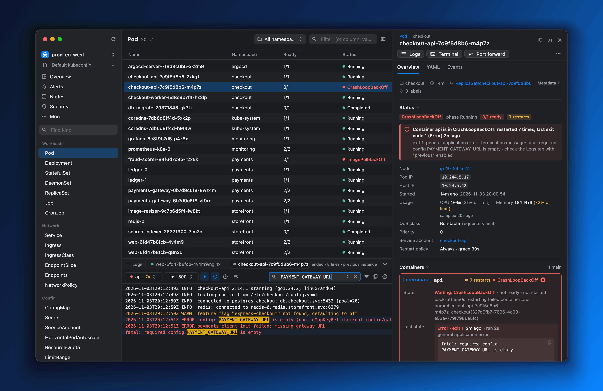

## Why k8sman

- **Live tables you shape with jq.** Every resource type, CRDs included, streams
  in over watches. Columns are jq expressions you edit with a live preview.
- **An inspector that explains why.** k8sman doesn't just print `0/1 ready`. It
  tells you the container crash-looped 7 times with exit code 1, shows the
  termination message, and links you to the previous instance's logs.
- **Logs, terminals, alerts and port-forwards in one place.** A bottom dock
  holds alerts and tabs for logs and shells, including a local shell whose
  `kubectl` follows the cluster on screen. Port-forwards survive pod restarts
  and app relaunches.
- **GitOps and Helm built in.** You get Argo CD sync, health and per-resource
  diffs, and Helm history diffs, rollbacks and dry-run upgrades, without leaving
  the app.
- **Security insights.** See network exposure, risky RBAC, Pod Security
  failures, best practices and image CVEs ranked across the cluster.

It's a real desktop app for macOS, Windows and Linux: a single download with the
backend embedded, nothing to run in your cluster, and nothing that leaves your
machine.

<table>
<tr><td><b>Every kind</b><br>Built-ins and CRDs, discovered live</td><td><b>30+ kind panels</b><br>Pods to Gateways to Argo CD apps</td><td><b>Cluster pages</b><br>Overview, Nodes, Security, Metrics, Helm, Add-ons, plus Alerts and Forwards in the dock</td></tr>
<tr><td><b>Local only</b><br>Listens on 127.0.0.1, no telemetry</td><td><b>Native</b><br>Vibrancy, unified titlebar, dark and light</td><td><b>Self-updating</b><br>Signed Sparkle updates</td></tr>
</table>

## Feature tour

### Jump anywhere, filter anything

<picture><source srcset="docs/images/demo-palette.avif" type="image/avif">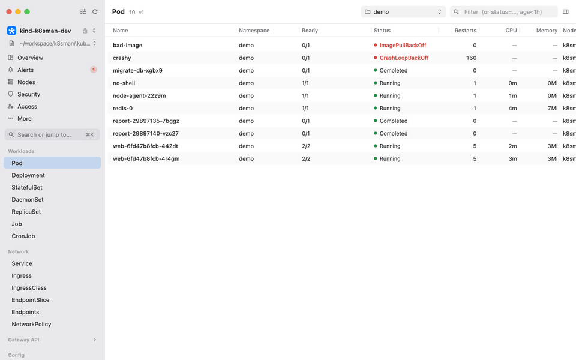</picture>

- **⌘K** (Ctrl+K on Windows and Linux) opens the command palette from any
  page: pages, resource kinds (short names like `svc` work), namespaces,
  contexts, actions, and objects by name.
- Pick **several namespaces** at once in the namespace picker (or `:ns a,b`):
  tables, Overview, Security, Alerts and Metrics show just those, even when
  your access covers only those namespaces.

<picture><source srcset="docs/images/demo-filter.avif" type="image/avif">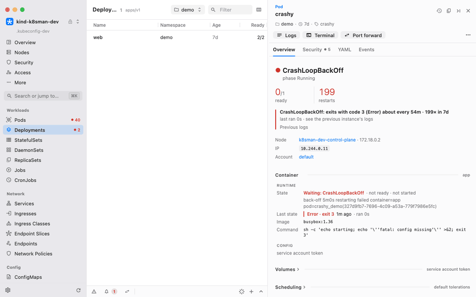</picture>

- The **filter box** helps you write queries: it suggests columns, then the
  values seen in that column (Tab or Return to pick). Terms combine:
  `status=Running restarts>3`, `status!=Running`, `memory>256Mi`, `age<1h`.

### Cluster health at a glance

<picture><source srcset="docs/images/demo-overview.avif" type="image/avif">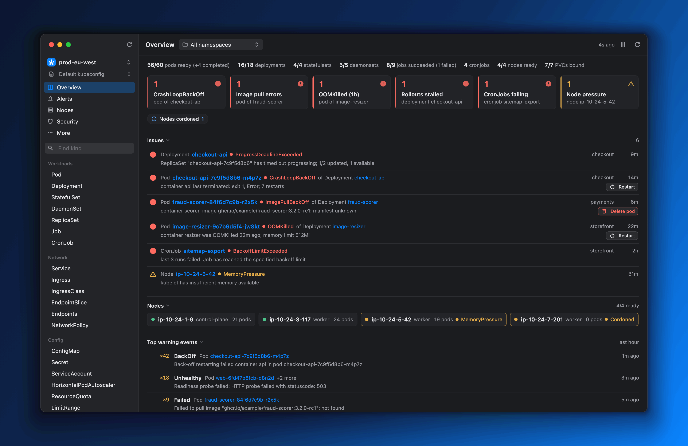</picture>

- The **Overview** page ranks what's wrong: crash loops, image pull errors,
  OOM kills, stalled rollouts, failing CronJobs, node pressure, lost PVCs and more.
- Issues are grouped under the workload that owns them, with quick fixes such
  as Restart, Delete pod or Resume rollout.
- Top warning events from the last hour are deduplicated and counted.
- **Alerts** in the bottom dock shows firing Alertmanager alerts and
  silences. A badge on its tab shows when something critical is firing.

### Workloads and the inspector

- Select any row to open the **inspector**: a kind-specific overview, YAML and
  events, plus actions in the header.
- The Pod panel explains why a pod isn't ready. It also shows containers,
  probes, env references, volumes, scheduling, QoS and usage against requests
  and limits.
- Panels cross-link related objects (owners, selected pods, mounting
  workloads, routes) and you can navigate back.
- Edit YAML with server-side dry-run validation, a diff review before you
  apply, and conflict detection when the object changed underneath you.
- **Open in Editor** gives a full-window, split-screen YAML editor: a live
  diff against the server on the right, validation errors pinned to lines,
  and the target context and namespace always in view.
- **Create resources** in the same editor from templates (Deployment, Service,
  ConfigMap, Secret, Job, CronJob, Ingress, PVC, Namespace, ServiceAccount,
  Role + RoleBinding) or pasted multi-document YAML. A dry run shows the
  result for each document before anything is created.

### Logs, terminals and port-forwards

<picture><source srcset="docs/images/demo-logs.avif" type="image/avif">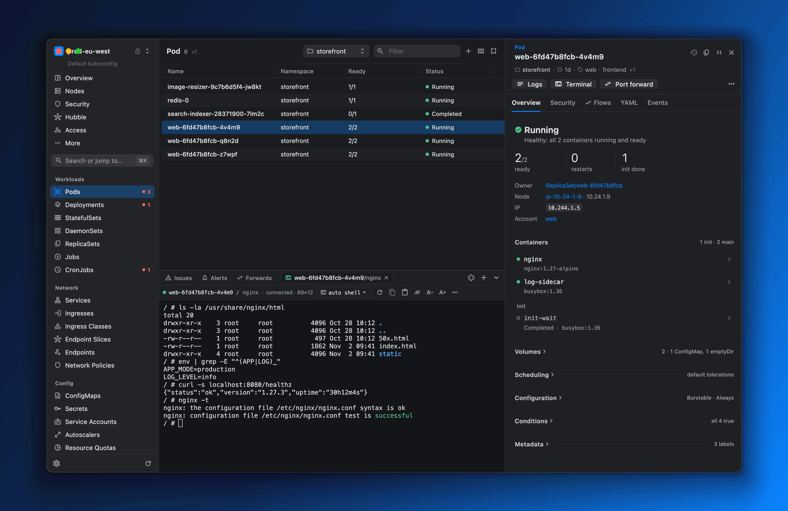</picture>

- **Logs**: follow, previous instance, timestamps, wrap, and search with
  highlighting or "only matching".
- **Aggregated logs**: press `l` on a Deployment, StatefulSet, DaemonSet,
  ReplicaSet, Job or Service (or on two or more selected pods) to see all its
  pods in one tab, merged by timestamp, each line labelled and colour-coded by
  pod (and container). The pod set follows rollouts and scaling live; hide
  sources or search by pod name, or switch to the previous instances. **Logs**
  on an Argo Workflow opens the same tab for its step pods.
- **Terminals**: open a shell in any container. k8sman tries zsh, bash, ash
  and sh. For distroless images it offers an ephemeral debug container.
- **Local shells** (macOS and Linux): **+** in the dock opens your login
  shell on this machine. Its `kubectl`, `helm` and `k9s` target the context
  you're viewing, without changing your kubeconfig.
- **Alerts**: the dock's first tab shows firing Alertmanager alerts and
  silences, with a badge when something critical is firing, so you can watch
  them while you work.
- **Port-forwards** reconnect to a fresh pod when theirs goes away, persist
  across launches, and can auto-start. They live in the dock's **Forwards**
  tab, whose badge shows how many are running.
- **⌘J** expands or collapses the dock. Tabs keep streaming while you browse.

### Argo CD, with real diffs

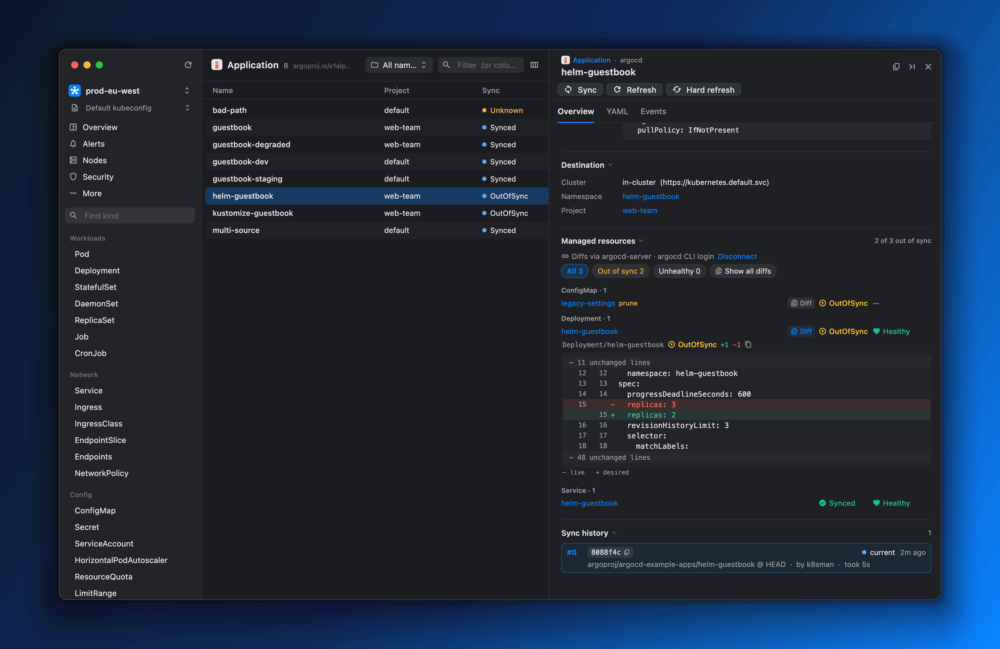

- Application, ApplicationSet and AppProject panels show sync and health, the
  managed resource tree, sync history, the last operation and sync windows.
- **Sync**, **Refresh**, **Hard refresh** and **Terminate** run from the inspector.
- Per-resource **live vs desired diffs** come from argocd-server. Connect with
  your existing `argocd login --sso` (the token stays in the argocd CLI's own
  config), with a pasted token, or with the initial admin password.

### Helm releases

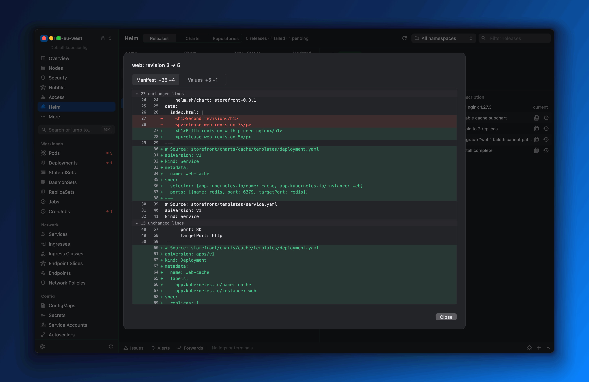

- See releases across namespaces with values, manifest, hooks, notes and
  resources.
- **Diff any two revisions** (manifest and values) and roll back to a revision.
- **Upgrade with edited values**: a dry run shows the diff before anything
  changes.
- k8sman detects releases stuck in `pending-*` and offers the rollback that
  recovers them. You can also uninstall, optionally keeping history.

### Security

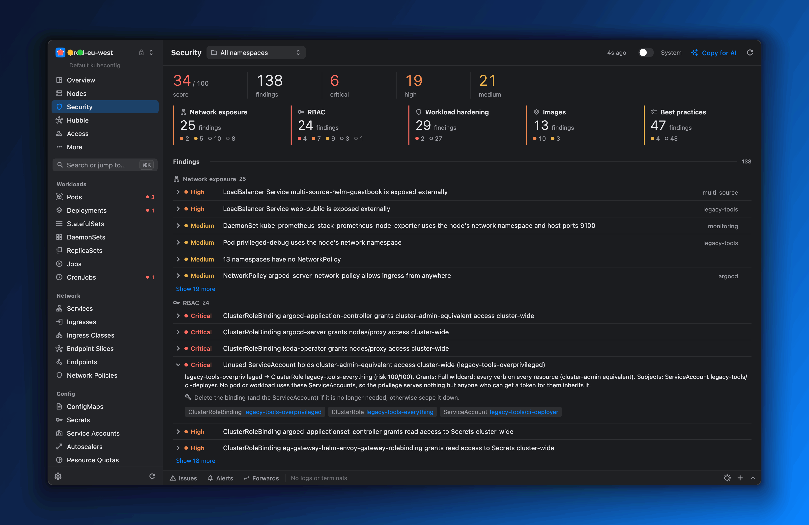

- A cluster score and ranked findings across **network exposure**, **RBAC**,
  **workload hardening** (Pod Security baseline and restricted),
  **images** and **best practices**.
- RBAC analysis flags cluster-admin-equivalent grants, secret readers, and
  privileged ServiceAccounts that no pod uses.
- Image CVEs come from Trivy Operator reports, or from on-demand scans with a
  local `trivy` CLI.
- **Copy for AI** puts a Markdown brief of the findings on your clipboard.

### Nodes, metrics and Prometheus

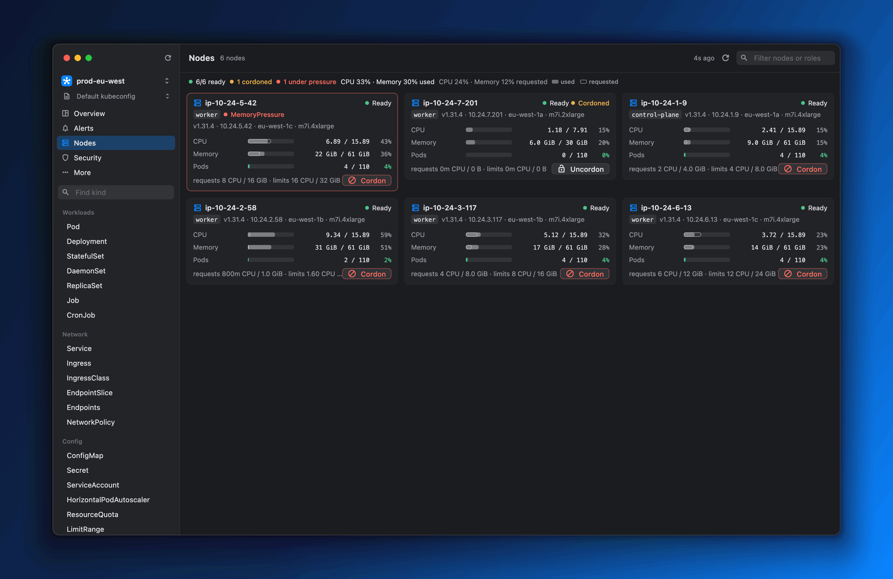

- The **Nodes** page lists nodes grouped by role, with live usage from
  metrics-server next to requests and limits, pressure and cordon state.
  Each node's menu cordons, uncordons or **drains** it. A drain shows which
  pods it will evict first, and respects PodDisruptionBudgets.
- The **Metrics** page has Top pods and nodes, custom and external metrics
  (for example KEDA), and a live HPA view.
- With Prometheus installed, Pod and Node panels gain 1h/6h history charts.
  PrometheusRule panels show live rule state, and ServiceMonitor/PodMonitor
  panels show scrape-target health. k8sman reaches Prometheus through the
  Kubernetes service proxy, so you don't need a port-forward.

### Gateway API

- Gateway, GatewayClass, route (HTTPRoute, GRPCRoute, …) and ReferenceGrant
  panels.
- Status conditions are explained in plain English: why a route wasn't
  accepted and which listener it attached to.
- Each route comes with a ready-to-run `curl` hint.

### Add-ons

- One-click Helm installs of **metrics-server**, the **Prometheus stack**,
  **Trivy Operator**, **Argo CD**, **Envoy Gateway** and **cert-manager**.
- Pick a chart version, review the dry-run, and install.

### Multi-select and bulk actions

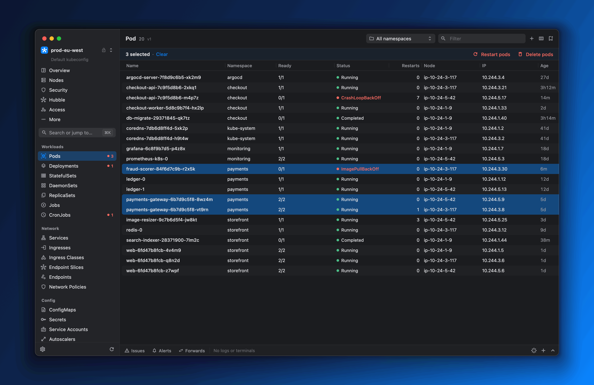

- **⌘-click**, **⇧-click** and **⌘A** select rows. ⇧↑/⇧↓ extends the selection.
- Bulk restart and delete show progress, then a summary of any failures.
- Right-click any row to open it, copy its name or YAML, or run its actions.

### Columns you define

<picture><source srcset="docs/images/demo-columns.avif" type="image/avif">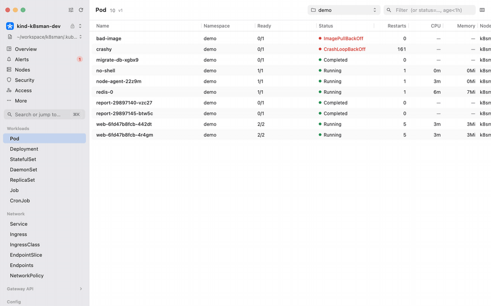</picture>

- **Drag a header** to move a column and **drag a divider** to resize it
  (double-click to reset). Tables remember their sort, widths and filter
  across launches.

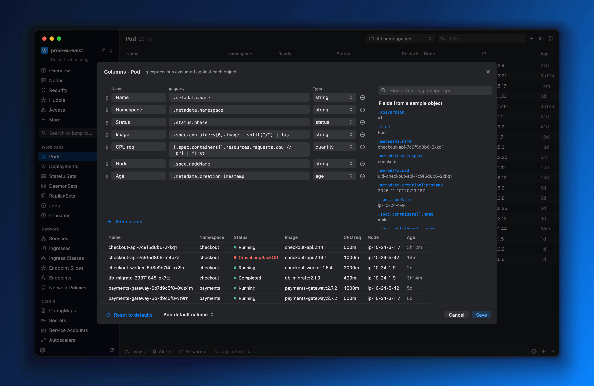

- Each column is a **jq expression** with a type: string, number, quantity,
  percent, age, status, bool or labels.
- A field picker lists paths from a sample object, and a live preview runs
  your columns against the cluster.
- Columns are saved per resource type. Sorting understands quantities
  (`500m` < `2`), and the filter compares them by value (`memory>256Mi`).

### Native macOS feel

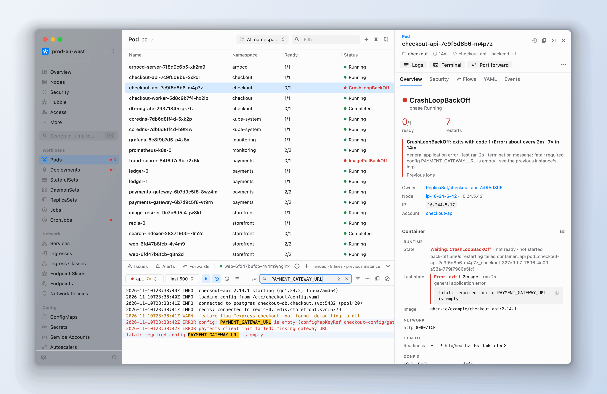

- Sidebar vibrancy, a unified titlebar, and it follows the system dark or
  light appearance.
- A single universal app (Apple silicon and Intel) with the Go backend
  embedded and supervised. Your login-shell environment is passed through, so
  `aws`, `gke-gcloud-auth-plugin` and `kubelogin` exec plugins just work.
- It remembers the window size and position. Tabs switch instantly, without
  animated transitions.

## All features

The tour above covers the highlights. [docs/FEATURES.md](docs/FEATURES.md)
lists everything: navigation, tables, every kind panel, Argo CD, Helm,
metrics, security, port-forwards and more.

## Install

### macOS

1. Download `k8sman-<version>-macos.dmg` from
   [**Releases**](https://github.com/matty234/k8sman/releases/latest) and open
   it. It's a universal app for Apple silicon and Intel and needs macOS 12 or
   later.
2. Drag `k8sman.app` onto the **Applications** shortcut beside it, then open
   it from Applications. Releases are signed with a Developer ID and notarized
   by Apple, so it opens without a Gatekeeper warning. If you run it straight
   from the disk image or Downloads, it offers to move itself into
   Applications, where it can update itself.

A `.zip` of the same app is attached too; it's what in-app updates and
Homebrew use. (Releases up to 0.2.7 weren't notarized: if one of those is
blocked, open **System Settings → Privacy & Security** and click **Open
Anyway**.)

To verify a download against the release's `SHA256SUMS`, run
`shasum -a 256 -c SHA256SUMS`.

**Homebrew.** Install from the
[matty234/tap](https://github.com/matty234/homebrew-tap) tap. Homebrew 7
and later only load casks from third-party taps you have trusted, so trust
it first:

```sh
brew trust matty234/tap
brew install --cask matty234/tap/k8sman
```

k8sman updates itself, so `brew upgrade` skips it unless you pass
`--greedy`.

### Windows

Windows 10 or 11 (x64). From
[**Releases**](https://github.com/matty234/k8sman/releases/latest), download
either:

- `k8sman-<version>-windows-x64-setup.exe`: installs k8sman for your user
  (no admin rights) with a Start menu entry and an uninstaller, or
- `k8sman-<version>-windows-x64.zip`: a portable copy. Unzip it anywhere and
  run `k8sman.exe` (keep `k8sman-server.exe` next to it).

**First launch (SmartScreen):** the Windows builds aren't code-signed, so
Microsoft Defender SmartScreen may say "Windows protected your PC". Click
**More info**, then **Run anyway**. To check a download first, run
`Get-FileHash <file>` in PowerShell and compare it with `SHA256SUMS`.

k8sman reads `%USERPROFILE%\.kube\config` (or `$KUBECONFIG`) and keeps its
own settings in `%USERPROFILE%\.config\k8sman`. Exec credential plugins
(`kubelogin`, `gke-gcloud-auth-plugin`, `aws`, …) must be on your `PATH`.

### Linux

x64, glibc 2.35 or newer (Ubuntu 22.04, Debian 12, Fedora 36 and later),
with GTK 3. From
[**Releases**](https://github.com/matty234/k8sman/releases/latest), download
either:

- `k8sman_<version>_amd64.deb` for Debian and Ubuntu:
  `sudo apt install ./k8sman_<version>_amd64.deb`. It installs to
  `/opt/k8sman` with a `k8sman` command and an app-menu entry, or
- `k8sman-<version>-linux-x64.tar.gz` for anything else: unpack it anywhere
  and run `./k8sman` (keep `k8sman-server` next to it). `./install.sh` adds
  an app-menu launcher and `~/.local/bin/k8sman` for your user;
  `./install.sh --uninstall` removes them.

k8sman reads `~/.kube/config` (or `$KUBECONFIG`) and keeps its settings in
`~/.config/k8sman`. Exec credential plugins must be on your `PATH`.

### Updates

On macOS k8sman updates itself with [Sparkle](https://sparkle-project.org):
it checks at launch and every 6 hours, and a banner offers **Install &
Relaunch…** (updates are EdDSA-signed). On Windows and Linux the same check
links to the download. See [docs/UPDATES.md](docs/UPDATES.md).

## Quick start

1. Open k8sman. It uses your current kubeconfig (`$KUBECONFIG` or
   `~/.kube/config`) and context.
2. To use another file, pick it from the kubeconfig menu under the context
   switcher, or choose **Choose file…**. k8sman remembers the file and the last
   context you used in each one.
3. Start on **Overview** to see what's broken, or pick a kind in the sidebar.
   Click a row to inspect it, press **⌘J** for the dock, and **⌘I** to fold the
   inspector away.

Nothing is installed in your cluster. k8sman uses your kubeconfig credentials
exactly as `kubectl` does.

## Safety and privacy

- **Local only, and locked.** The embedded backend listens on `127.0.0.1` on
  a random port, never on an external interface. Every request must carry a
  secret token the app generates at each launch, so web pages and other user
  accounts on your Mac can't use it. It also rejects foreign `Host` and
  `Origin` headers (DNS rebinding) and non-JSON writes (cross-site requests).
- **Local shells run as you.** A local shell tab is your own login shell, so
  that token guards a real shell on your machine too. Read-only mode can't
  restrict what you run there, and on read-only contexts the tab says so.
- **No telemetry.** k8sman has no analytics, crash reporting or usage
  tracking. The only outbound requests besides your clusters are:
  - the periodic update check (which you can turn off);
  - CRD icon favicons, only for local clusters by default;
  - chart repositories when you install an add-on;
  - the Argo CD API when you connect it;
  - `trivy`'s own vulnerability database download when you scan.
- **Confirmations name the context.** Every mutating action says which context
  it will change, and warns when that isn't a local cluster.
- **Production starts read-only.** A context whose name contains `prod`,
  `production` or `prd` as a word (`prod-eu`, `gke_acme_prod`, not
  `product-api`) is read-only until you click its lock and confirm. Lock any
  other context the same way. The backend enforces it (HTTP 403), not just
  the UI. Start the backend with `--read-only` to lock every context; in the
  app, run `defaults write dev.k8sman.app BackendArgs -array --read-only`.
- **Credentials stay put.**
  - The kubeconfig listing returns only file paths and context names, never
    their contents.
  - The backend logs only each request's method and URL. Tokens travel in
    request bodies, so they are never written to logs.
  - With an argocd CLI login, the token stays in the argocd CLI's own config.
    k8sman reads it when needed and never copies it.
  - A pasted Argo CD token is stored in `~/.config/k8sman/settings.json`
    (mode 0600).
- **No App Sandbox.** The app runs unsandboxed because it must read `~/.kube`
  and cloud credentials and run exec auth plugins, which the sandbox forbids.

## Keyboard shortcuts

| Shortcut | Action |
|---|---|
| ⌘K or ⌘P | Command palette: jump to a page, kind, namespace, context or object (in a focused terminal, ⌘K clears it) |
| ⌘J | Expand or collapse the bottom dock (alerts, logs and terminals) |
| ⌘I | Collapse or expand the inspector |
| ⌘A | Select all visible rows |
| ⌘-click / ⇧-click | Toggle a row / select a range |
| ↑ / ↓, ⇧↑ / ⇧↓ | Move the selection / extend it |
| ⌘⌫ | Delete the selected rows (with confirmation) |
| Esc | Clear a multi-selection, else close the inspector; leave an unchanged YAML edit; close pickers |
| ⌘S | YAML editor: review and apply (full-window editor: validate, review, apply) |
| ⌘F | YAML editor: find |
| ⌘↩ | Run the dry run (Helm upgrade), apply (add-on install), or apply or create (full-window editor) |
| ⌘+ / ⌘− / ⌘0, ⌘K | Terminal: font size, clear |

On Windows and Linux, use Ctrl in place of ⌘. In a terminal tab, Ctrl keys go to the
shell: copy with Ctrl+Shift+C and paste with Ctrl+V.

## Build from source

You need Flutter (stable) and Go 1.27+; for the sample cluster, also
[kind](https://kind.sigs.k8s.io) and kubectl.

```sh
make cluster    # a kind cluster with sample workloads (writes .kubeconfig-dev)
make app        # run the macOS app; builds and embeds the backend
make test       # go vet + go test, flutter analyze, flutter test
```

[docs/DEVELOPMENT.md](docs/DEVELOPMENT.md) covers Windows and Linux builds,
releases, the code layout and the rest of the docs ([API.md](API.md) lists
every backend endpoint).

## Architecture

The app is a Flutter desktop UI (macOS, Windows and Linux) with an embedded Go
backend (client-go). The app starts the backend on `127.0.0.1`, supervises it
(`BackendSupervisor.swift` on macOS, `lib/app/backend_supervisor.dart` on
Windows and Linux), and talks to it over HTTP and
WebSockets: watches, logs, exec and port-forwards. The backend holds the
kubeconfig and does the cluster work. Argo CD, Prometheus and Alertmanager are
reached in-cluster through the Kubernetes API's service proxy.

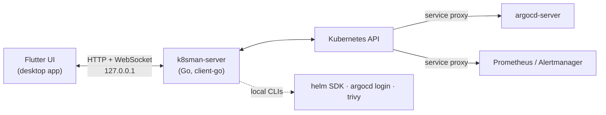

More in [docs/DEVELOPMENT.md](docs/DEVELOPMENT.md).

## Roadmap and contributing

Next on the list:

- More kind panels and Overview checks.

Issues and pull requests are welcome. Before opening a PR, run `make test`.
For a new inspector panel, start with [docs/PANELS.md](docs/PANELS.md). The
screenshots in this README are rendered headlessly from demo data
(`make shots`), so UI changes can refresh them without touching a real cluster.

## License

Apache-2.0. See [LICENSE](LICENSE) and [NOTICE](NOTICE). Bundled third-party
icons are subject to their own terms; see
[ATTRIBUTION.md](frontend/assets/icons/ATTRIBUTION.md). CNCF project artwork
is used under the
[Linux Foundation trademark guidelines](https://www.linuxfoundation.org/legal/trademark-usage).
