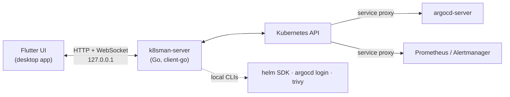

# Development

## Build from source

Requirements: macOS, Flutter (stable), Go 1.27+, and for the dev cluster
[kind](https://kind.sigs.k8s.io) and kubectl.

```sh
make cluster    # create the k8sman-dev kind cluster (writes .kubeconfig-dev) and load samples
make app        # flutter run -d macos; builds and embeds the backend automatically
make test       # go vet + go test, flutter analyze, flutter test
make release    # dist/k8sman-<version>-macos.zip + SHA256SUMS (universal)
make shots      # re-render the README screenshots into docs/images (demo data)
```

On Windows you need Visual Studio 2022 with the "Desktop development with
C++" workload, Flutter and Go. `cd frontend && flutter run -d windows` builds
the app; its CMake build compiles `k8sman-server.exe` next to `k8sman.exe`.
Release builds for Windows come from
[`.github/workflows/windows.yml`](../.github/workflows/windows.yml) (installer
script: [`packaging/windows/k8sman.iss`](../packaging/windows/k8sman.iss)).

On Linux you need Flutter's Linux toolchain (`clang cmake ninja-build
pkg-config libgtk-3-dev`) and Go. `cd frontend && flutter run -d linux` builds
the app; its CMake build compiles `k8sman-server` next to `k8sman`. Release
builds come from [`.github/workflows/linux.yml`](../.github/workflows/linux.yml)
(packaging: [`packaging/linux/package.sh`](../packaging/linux/package.sh)).

More documentation:

- [API.md](../API.md): every backend endpoint.
- [PANELS.md](PANELS.md): how kind-specific inspector panels are built.
- [ARGOCD.md](ARGOCD.md): Argo CD panels and diffs.
- [GATEWAY_API.md](GATEWAY_API.md): Gateway API panels.
- [SECURITY.md](SECURITY.md): the Security page's checks.
- [METRICS.md](METRICS.md): metrics-server, custom and external metrics.
- [PROMETHEUS.md](PROMETHEUS.md): Prometheus, Alertmanager and monitor panels.
- [UPDATES.md](UPDATES.md): Sparkle updates, signing and releases.

## Architecture

The app is a Flutter desktop UI (macOS, Windows and Linux) with an embedded Go
backend (client-go). The app starts the backend on `127.0.0.1`, supervises it
(`BackendSupervisor.swift` on macOS, `lib/app/backend_supervisor.dart` on
Windows and Linux), and talks to it over HTTP and
WebSockets: watches, logs, exec and port-forwards. The backend holds the
kubeconfig and does the cluster work. Argo CD, Prometheus and Alertmanager are
reached in-cluster through the Kubernetes API's service proxy.



### Development

The Xcode project has a **Build k8sman-server** run-script phase
(`tools/build-backend.sh`). It compiles the Go backend for the target
architectures and copies it into `k8sman.app/Contents/MacOS/k8sman-server`, so
`flutter run -d macos` and `flutter build macos` both produce a self-contained
app. The script finds `go` in your PATH, `/opt/homebrew/bin` or
`/usr/local/go/bin`, and builds with `GOTOOLCHAIN=local`.

To work on the backend with a hot-restartable server instead:

```sh
make backend    # standalone server on 127.0.0.1:7443 against the dev cluster
make app-dev    # app using that server (--dart-define=K8SMAN_BACKEND=http://127.0.0.1:7443)
```

The backend requires a bearer token on every request (see "Access control"
in API.md). `make backend` generates one per start and writes it to
`~/.config/k8sman/dev-token` (mode 0600); the app run by `make app-dev` reads
that file at launch, so after restarting the backend, hot-restart the app
(`R` in `flutter run`). To use another token, pass
`--dart-define=K8SMAN_TOKEN=…` to `flutter run` and set `K8SMAN_AUTH_TOKEN`
for the server. For curl:
`curl -H "Authorization: Bearer $(cat ~/.config/k8sman/dev-token)" http://127.0.0.1:7443/api/health`.

The embedded backend is started with `--addr 127.0.0.1:0` and a fresh random
token in `K8SMAN_AUTH_TOKEN`, and the app learns
the port from its `K8SMAN_LISTENING <addr>` stdout line. To pass extra flags
to it, run for example
`defaults write dev.k8sman.app BackendArgs -array --read-only`.

### Release build

```sh
make release    # dist/k8sman-<version>-macos.zip + SHA256SUMS
make appcast    # dist/appcast.xml: EdDSA-signed update feed (needs the signing key)
make update-e2e # local update test: two versions, local feed, tamper checks
```

`make release` builds a universal (arm64 + x86_64) Release `.app` with the
embedded backend and Sparkle, signs it and zips it. The version comes from
`frontend/pubspec.yaml`. Locally it's ad-hoc signed; with
`MACOS_SIGN_IDENTITY` (and `NOTARIZE=1`) it's Developer ID signed and
notarized, as in CI (see [UPDATES.md](UPDATES.md#developer-id-and-notarization)).

Pushing a `v*` tag runs `.github/workflows/release.yml`, which builds, signs
and publishes the GitHub release. See [UPDATES.md](UPDATES.md)
for the signing keys, release steps and the notarization path.

### Layout

```
frontend/  Flutter macOS app
  lib/app/          backend launcher (BackendController), kubeconfig picker, window chrome, updates/
  lib/api/          Dart client for the backend API
  lib/state/        app state (context, types, namespace, selection)
  lib/ui/, panels/  shell, tables, detail sidebar, kind-specific panels
  macos/Runner/     native window (vibrancy, titlebar), BackendSupervisor.swift, UpdateController.swift (Sparkle)
backend/   Go server (client-go)
  cmd/k8sman-server/   entry point and flags
  internal/cluster/    kubeconfig loading, context and kubeconfig switching, discovery
  internal/server/     HTTP and WebSocket API
  internal/portforward supervised port-forwards
  internal/settings/   ~/.config/k8sman/settings.json
  internal/icons/      CRD group icons: Helm chart icons, bundled icons, favicons
tools/     build-backend.sh, app icon generator, release/update tooling, marketing-shots.sh
packaging/ Homebrew cask template
```

- **Backend supervision** (`frontend/macos/Runner/BackendSupervisor.swift`):
  - The app spawns the backend with your login-shell environment (`$SHELL -l`),
    so kubeconfig exec credential plugins such as `aws`,
    `gke-gcloud-auth-plugin` and `kubelogin` are found.
  - It restarts the backend with exponential backoff if it crashes, and
    shows the backend's output with a Retry button if it can't start.
  - On quit it sends SIGTERM, and the backend stops its port-forwards. The
    backend also exits if its stdin closes, so it never outlives the app.
- **Local state** lives in `~/.config/k8sman/`:
  - `settings.json`: the chosen kubeconfig, recent kubeconfigs, the last
    context per kubeconfig, and `remoteIcons`.
  - `columns.json`: custom columns.
  - `portforwards.json`: saved forwards.
- **CRD icons** come from Helm chart metadata, icons bundled with the app, or
  the group's website favicon (fetched directly, never through a third-party
  favicon service). See [API.md](../API.md#crd-group-icons).

