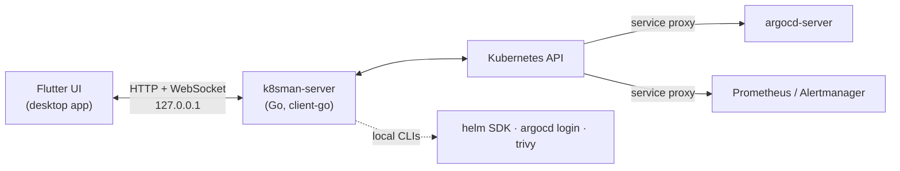

# Development

## Build from source

Requirements: macOS, Flutter (stable), Go 1.27+, and for the dev cluster
[kind](https://kind.sigs.k8s.io) and kubectl.

```sh
make cluster    # create the k8sman-dev kind cluster (writes .kubeconfig-dev) and load samples
make app        # flutter run -d macos; builds and embeds the backend automatically
make test       # go vet + go test, flutter analyze, flutter test
make release    # dist/k8sman-<version>-macos.zip + SHA256SUMS (universal)
make shots      # re-render the README screenshots into docs/images (demo data)
```

On Windows you need Visual Studio 2022 with the "Desktop development with
C++" workload, Flutter and Go. `cd frontend && flutter run -d windows` builds
the app; its CMake build compiles `k8sman-server.exe` next to `k8sman.exe`.
Release builds for Windows come from
[`.github/workflows/windows.yml`](../.github/workflows/windows.yml) (installer
script: [`packaging/windows/k8sman.iss`](../packaging/windows/k8sman.iss)).

On Linux you need Flutter's Linux toolchain (`clang cmake ninja-build
pkg-config libgtk-3-dev`) and Go. `cd frontend && flutter run -d linux` builds
the app; its CMake build compiles `k8sman-server` next to `k8sman`. Release
builds come from [`.github/workflows/linux.yml`](../.github/workflows/linux.yml)
(packaging: [`packaging/linux/package.sh`](../packaging/linux/package.sh)).

More documentation:

- [API.md](../API.md): every backend endpoint.
- [PANELS.md](PANELS.md): how kind-specific inspector panels are built.
- [ARGOCD.md](ARGOCD.md): Argo CD panels and diffs.
- [GATEWAY_API.md](GATEWAY_API.md): Gateway API panels.
- [SECURITY.md](SECURITY.md): the Security page's checks.
- [METRICS.md](METRICS.md): metrics-server, custom and external metrics.
- [PROMETHEUS.md](PROMETHEUS.md): Prometheus, Alertmanager and monitor panels.
- [UPDATES.md](UPDATES.md): Sparkle updates, signing and releases.
- [PLUGINS.md](PLUGINS.md): runtime plugins (`plugin.yaml` + CEL), and
  [writing one](PLUGINS.md#writing-a-plugin).

## Architecture

The app is a Flutter desktop UI (macOS, Windows and Linux) with an embedded Go
backend (client-go). The app starts the backend on `127.0.0.1`, supervises it
(`BackendSupervisor.swift` on macOS, `lib/app/backend_supervisor.dart` on
Windows and Linux), and talks to it over HTTP and
WebSockets: watches, logs, exec and port-forwards. The backend holds the
kubeconfig and does the cluster work. Argo CD, Prometheus and Alertmanager are
reached in-cluster through the Kubernetes API's service proxy.



### Development

The Xcode project has a **Build k8sman-server** run-script phase
(`tools/build-backend.sh`). It compiles the Go backend for the target
architectures and copies it into `k8sman.app/Contents/MacOS/k8sman-server`, so
`flutter run -d macos` and `flutter build macos` both produce a self-contained
app. The script finds `go` in your PATH, `/opt/homebrew/bin` or
`/usr/local/go/bin`, and builds with `GOTOOLCHAIN=local`.

To work on the backend with a hot-restartable server instead:

```sh
make backend    # standalone server on 127.0.0.1:7443 against the dev cluster
make app-dev    # app using that server (--dart-define=K8SMAN_BACKEND=http://127.0.0.1:7443)
```

The backend requires a bearer token on every request (see "Access control"
in API.md). `make backend` generates one per start and writes it to
`~/.config/k8sman/dev-token` (mode 0600); the app run by `make app-dev` reads
that file at launch, so after restarting the backend, hot-restart the app
(`R` in `flutter run`). To use another token, pass
`--dart-define=K8SMAN_TOKEN=…` to `flutter run` and set `K8SMAN_AUTH_TOKEN`
for the server. For curl:
`curl -H "Authorization: Bearer $(cat ~/.config/k8sman/dev-token)" http://127.0.0.1:7443/api/health`.

The embedded backend is started with `--addr 127.0.0.1:0` and a fresh random
token in `K8SMAN_AUTH_TOKEN`, and the app learns
the port from its `K8SMAN_LISTENING <addr>` stdout line. To pass extra flags
to it, run for example
`defaults write dev.k8sman.app BackendArgs -array --read-only`.

### Release build

```sh
make release    # dist/k8sman-<version>-macos.zip + SHA256SUMS
make appcast    # dist/appcast.xml: EdDSA-signed update feed (needs the signing key)
make update-e2e # local update test: two versions, local feed, tamper checks
```

`make release` builds a universal (arm64 + x86_64) Release `.app` with the
embedded backend and Sparkle, signs it and zips it. The version comes from
`frontend/pubspec.yaml`. Locally it's ad-hoc signed; with
`MACOS_SIGN_IDENTITY` (and `NOTARIZE=1`) it's Developer ID signed and
notarized, as in CI (see [UPDATES.md](UPDATES.md#developer-id-and-notarization)).

Pushing a `v*` tag runs `.github/workflows/release.yml`, which builds, signs
and publishes the GitHub release. See [UPDATES.md](UPDATES.md)
for the signing keys, release steps and the notarization path.

### Layout

```
frontend/  Flutter macOS app
  lib/app/          backend launcher (BackendController), kubeconfig picker, window chrome, updates/
  lib/api/          Dart client for the backend API
  lib/state/        app state (context, types, namespace, selection)
  lib/ui/, panels/  shell, tables, detail sidebar, kind-specific panels
  macos/Runner/     native window (vibrancy, titlebar), BackendSupervisor.swift, UpdateController.swift (Sparkle)
backend/   Go server (client-go)
  cmd/k8sman-server/   entry point and flags
  internal/cluster/    kubeconfig loading, context and kubeconfig switching, discovery
  internal/server/     HTTP and WebSocket API
  internal/portforward supervised port-forwards, and in-process pod dialing (DialPod)
  internal/hubble/     Hubble Relay client: vendored protos (proto/, pb/), filters, streaming
  internal/settings/   ~/.config/k8sman/settings.json
  internal/icons/      CRD group icons: Helm chart icons, bundled icons, favicons
tools/     build-backend.sh, app icon generator, release/update tooling, marketing-shots.sh
packaging/ Homebrew cask template
```

- **Backend supervision** (`frontend/macos/Runner/BackendSupervisor.swift`):
  - The app spawns the backend with your login-shell environment (`$SHELL -l`),
    so kubeconfig exec credential plugins such as `aws`,
    `gke-gcloud-auth-plugin` and `kubelogin` are found.
  - It restarts the backend with exponential backoff if it crashes, and
    shows the backend's output with a Retry button if it can't start.
  - On quit it sends SIGTERM, and the backend stops its port-forwards. The
    backend also exits if its stdin closes, so it never outlives the app.
- **Local state** lives in `~/.config/k8sman/`:
  - `settings.json`: the chosen kubeconfig, recent kubeconfigs, the last
    context per kubeconfig, `remoteIcons`, turned-off integrations and
    integrations' own settings (`moduleSettings`).
  - `columns.json`: custom columns.
  - `portforwards.json`: saved forwards.
  - `plugins/`: installed plugins (loaded in developer mode; see
    [PLUGINS.md](PLUGINS.md)). Developer mode, plugin folders, turned-off
    plugins and consent are `plugins` in `settings.json`.
- **Integrations** (Argo CD, Argo Workflows, Helm, GPUs, Prometheus,
  Gateway API, Cilium Hubble, Metrics, Add-ons) are compile-time modules; see
  [Adding an integration](#adding-an-integration).
- **CRD icons** come from Helm chart metadata, icons bundled with the app, or
  the group's website favicon (fetched directly, never through a third-party
  favicon service). See [API.md](../API.md#crd-group-icons).

## Plugins

Integrations below are compiled in. For your own operators and CRDs you
don't need to fork: write a plugin, a folder with a `plugin.yaml` that adds
table columns, inspector sections (with related objects and metrics),
shell and patch actions and overview alerts in YAML and CEL, evaluated by
the backend over the shared watch cache. Turn on **Settings ▸
Integrations ▸ Installed ▸ Developer ▸ Developer mode**, **Load plugin folder…** (try
[`examples/plugins/cert-manager`](../examples/plugins/cert-manager), a short
example; the full one is in the plugin directory,
`k8sman-plugins/plugins/cert-manager`, so turn that off or uninstall it
first: two plugins can't share an id), and
edit: it hot reloads and shows errors with their line. Or run
`make backend BACKEND_ARGS="--plugin-dev examples/plugins/cert-manager"`.
`k8sman-server plugin new <id>` starts one; `plugin validate <dir>` and
`plugin test <dir>` (golden snapshots of its fixtures) check one without a
cluster, e.g. in CI. See
[PLUGINS.md ▸ Writing a plugin](PLUGINS.md#writing-a-plugin).

## Adding an integration

Integrations with other tools (Argo CD, Helm, GPUs, …) are modules: one
interface on each side, compiled in, listed in one place. Core features
(tables, logs, terminals, port-forwards, nodes, security, access, the
editor) are not modules. Each module can be turned off in **Settings ▸
Integrations** (or the palette's **Integrations…**), saved as
`disabledModules` in `settings.json`. Use the same id on both sides.

A module can default to **auto** instead of on (only Hubble does): unless
the user turned it on (`enabledModules`) or off (`disabledModules`, which
wins), it is active only on a kube context where it is found. Backend: also
implement `AutoModule` (`AutoDetect`, cheap and cached; `AutoProbe`, the one
route that stays reachable so the UI can ask). While inactive its routes
answer 404 (`reason: "ModuleInactive"`) and it adds no overview inputs, so
nothing runs for it. Frontend: override `AppModule.autoByDefault` (with
`detect`); the palette, inspector tabs and sidebar then follow detection
(`moduleActive`), and Settings shows an "Auto" note on the row.

**Backend** (`backend/internal/server/module.go`):

1. Write a type that implements `Module`: `Name()` returns the id, and
   `Routes(r httpx.Router, d Deps)` mounts its endpoints on `r`. `Deps`
   carries the cluster manager, settings and the read-only guard
   (`d.RefuseReadOnly(w)` before anything that changes the cluster). Auth
   and the Host/Origin checks run before any route, so modules don't
   repeat them. Larger integrations keep their logic in their own package
   (`internal/argoapi`, `internal/helm`, …) with a
   `Register(mux httpx.Router, …)`.
2. Optionally implement:
   - `OverviewSource`: feed the health overview with `l.Go`. Either list
     objects into `overview.Input` for the overview package to analyse, or,
     when your module works out its own problems, append
     `overview.Finding`s to `in.Findings` (an issue plus the label and
     section of its summary tile), as Hubble does. Overview polls run
     every 10 s: never wait on a slow service there; serve a cached
     result and refresh it in the background.
   - `ActionSource`: actions for `POST /api/actions/{action}`; decode your
     body fields from `ActionCall.Body`.
   - `Configurable`: settings of your own (an address override, a TLS
     choice), saved per kube context in settings.json's `moduleSettings`
     and served by `GET/PUT /api/settings/modules/{id}`. You validate the
     JSON in `ValidateSettings`; read it with
     `d.Settings.ModuleSettings(id, context, &yourStruct)`. When the
     settings hold a secret (Argo CD's API token), also implement
     `SecretSettings`: GET then shows `RedactSettings` instead of what is
     saved, and a PUT body goes through `MergeSettings` first, so the UI
     can change one field without ever reading the secret back. Never
     log settings values.
3. Add it to `builtinModules()`. While it is turned off its routes answer
   404 (`reason: "ModuleDisabled"`) and it adds no overview inputs or
   actions.
4. Document the endpoints in API.md.

Reaching an in-cluster service: HTTP goes through the API server's service
proxy (`internal/svcproxy`, as Prometheus and Argo CD do). Anything else,
such as gRPC, can't: dial a pod with `portforward.ResolveService` and
`portforward.DialPod`, which return a `net.Conn` through the
`pods/portforward` subresource without listening on the machine (Hubble
hands that to gRPC's `WithContextDialer`). Streams to the UI are WebSockets
(`upgrade` in `stream.go`); for high-volume ones, filter at the source and
send batched frames with a rate cap, as `hubble.Stream` does, and keep
generated protocol code lean (Hubble vendors three `.proto` files rather
than importing Cilium).

**Frontend** (`frontend/lib/modules/`):

1. Add `<id>_module.dart` with a `const` class extending `AppModule`.
   Override what you have:
   - `pages` (`AppPage`: id `MainView('<id>')`, icon, label, builder, `:`
     commands, `after` for its default sidebar position, `underMore`, an
     optional `navGate`);
   - `panels` (inspector panels for your kinds, see [PANELS.md](PANELS.md))
     and `inspectorTabs(ctx)` (tabs you add to objects of *any* kind, e.g.
     Hubble's Flows tab on Pods and Deployments; return nothing for kinds
     you don't handle, and return quickly: it runs on every inspector
     rebuild);
   - `navGroups` (a section of the kinds list; integration sections follow the core ones, alphabetically),
     `kindIcons` and `requires` (other module ids it needs);
   - `description`: one line under the module's name in Settings (the
     settings search matches it);
   - `detect` when Settings ▸ Integrations (or a page, tab or section)
     should know how the module stands on the cluster: its CRDs or service
     found, whether it works. It takes the `ApiClient` and returns a
     `ModuleStatus` (checking, notInstalled, connected, error, plus a
     one-line message); throwing is an error status. It runs once per kube
     context, after the first table has painted, so keep it to one or two
     cheap backend calls and never stream. Read the cached status with
     `moduleStatuses.of(module, api, context)` and listen to
     `moduleStatuses` to rebuild when it lands (`refresh` detects again,
     e.g. after settings change). Examples: Hubble (relay), GPUs (nodes,
     then DCGM), Argo CD (CRD, argocd-server, sign-in), Argo Workflows
     (argo-server), Prometheus (instances), Gateway API (GatewayClasses and
     controllers), Metrics (metrics-server). Where discovery alone is
     enough (Helm, Add-ons) there is nothing to detect;
   - `navGate` on a page: use `ModuleNavGate(module: this, child: item)`
     (`module_nav_gate.dart`) to show the sidebar row only on clusters
     where `detect` found the integration (GPUs, Hubble; `showOnError:
     false` also hides it when the check failed);
   - `settingsBuilder`: a form for your `Configurable` settings, shown
     inline under the module's row in Settings ▸ Integrations (no title or
     Close button; keep a Save button only if the form needs one). Link to
     it from your pages with `openSettings(context, module: id)`
     (`ui/settings/settings_page.dart`). Read and save them with
     `ApiClient.getModuleSettings` / `putModuleSettings` (Hubble's form),
     or, when saving needs checks against the service, through your own
     endpoints (Argo CD's sign-in form verifies a token with Argo before
     saving it). Entry points elsewhere in the app, such as the Argo CD
     inspector's "Connect…", open the same form.
2. Add it to `builtInModules` in `modules.dart`, after any module whose
   page it is placed `after`.

For a live, high-volume list fed by your own WebSocket, use
`FrameStream<T>` (`lib/state/frame_stream.dart`) with
`ApiClient.jsonStream`: it connects, keeps the newest rows in a ring
buffer, counts what was lost, and pauses without losing rows while the
reader scrolls. Render it with a fixed-height `ListView.builder`, as
Hubble's `FlowList` does.

Overview issues: Hubble produces `overview.Finding`s itself. Argo CD,
Argo Workflows, Gateway API and alerts instead hand the overview their
objects, because the overview's counts (`counts.argoApps`, `gateways`,
`routes`), its fixed category order and its owner resolution for alerts
live in the overview package; a `Finding` can't carry those. Use findings
for new modules whose issues stand alone.

That's all: `shell.dart`, `app_state.dart`, `resource_nav.dart`, the
palette and `server.go` don't change. Saved sidebar layouts store page ids,
so keep a page's id once it has shipped.

